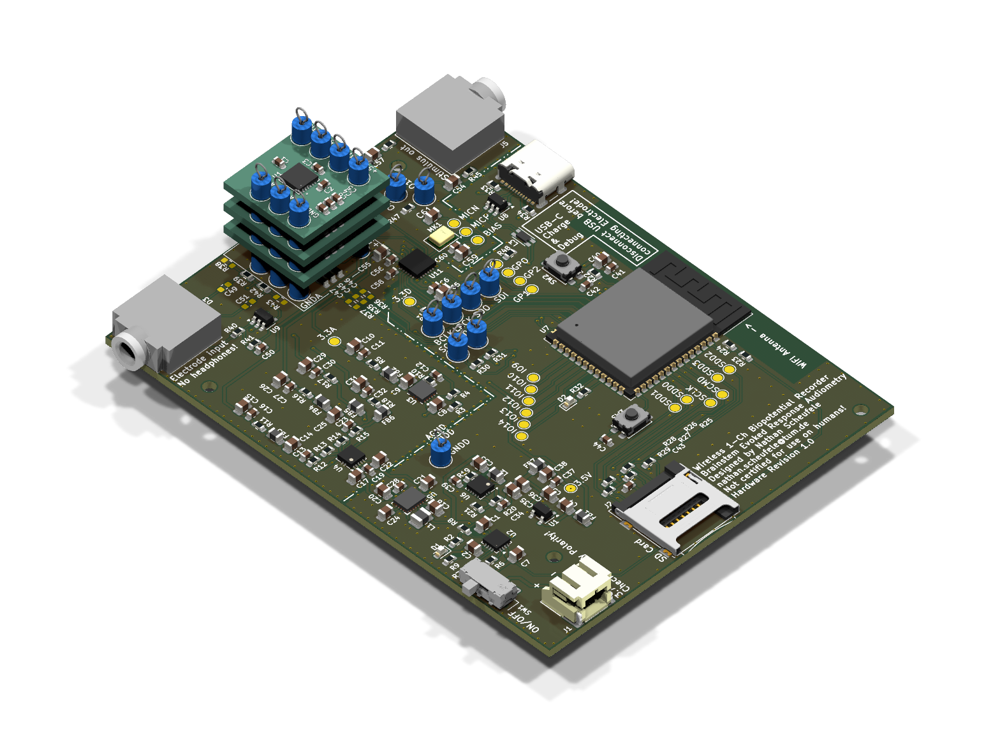

# Wireless BERA

**Wireless Biopotential Electrode Recording Amplifier**

A wireless, battery-powered biopotential recording system for EEG and auditory brainstem response (ABR/BERA) measurements.

> **BERA** stands for two things in this project:
> - **B**rainstem **E**voked **R**esponse **A**udiometry — the clinical application
> - **B**iopotential **E**lectrode **R**ecording **A**mplifier — the hardware

---

## Hardware

**MCU:** ESP32-S3-WROOM-1 — Wi-Fi 802.11 b/g/n + Bluetooth 5.0 LE

**Analog Front-End:**
- LTC6373 programmable-gain instrumentation amplifier (Gain: 0.25, 0.5, 1, 2, 4, 8, 16)
- TAC5212 24-bit ADC via I²S
- Infineon IM73A135 differential MEMS microphone (stimulus/environment monitoring)
- Driven Right Leg (DRL) circuit via OPA376 (active CMR)

**Power** — see [PowerArchitecture.pdf](docs/PowerArchitecture.pdf):


- BQ24074 single-cell Li-Ion charger
- TPS63000 buck-boost → 3.5 V regulated
- TPS65132W dual charge-pump → ±5.5 V raw
- TPS7A39 dual ultra-low-noise LDO → ±5 V (analog section)
- TPS7A94 LDO → 3.3 V analog
- TPS7A2033 LDO → 3.3 V digital
- Star-topology and LC filters on all analog supply rails

**Peripherals:** MicroSD (SDMMC 4-bit), USB-C (USB 2.0 + ESD)

**PCB:** 4-layer, split GNDA/GNDD

### Daughterboard
Optional plug-in for standalone LTC6373 evaluation at fixed Gain = 16. Stacking multiple daughterboards parallels the INA inputs, reducing equivalent input noise by √n.

---

>  **v1.0 — prototype fabricated at Aisler and assembled; bring-up in progress.**

## 3D Renderings

### Stacked Assembly (Main Board + 3x Daughterboards)
Three LTC6373 Daughterboards stacked on top of the main Wireless BERA board to parallel the inputs and reduce equivalent input noise by $\sqrt{n}$.



---

## Tools

- **EDA:** KiCad 10
- **Fabrication target:** Aisler (4-layer, HASL)
- **Firmware:** ESP-IDF (ESP32-S3) — see `firmware/`
- **Hardware Auditing & Design Review:** [kicad-happy](https://github.com/aklofas/kicad-happy) (located locally in `kicad-happy/`)

### Running the Hardware Audit
To perform a full design review of the schematic, layout, and EMC pre-compliance:
```bash
# Schematic Analysis
/opt/homebrew/bin/python3 kicad-happy/skills/kicad/scripts/analyze_schematic.py hardware/WirelessBERA.kicad_sch --output scratch/sch_analysis.json

# PCB Layout Analysis
/opt/homebrew/bin/python3 kicad-happy/skills/kicad/scripts/analyze_pcb.py hardware/WirelessBERA.kicad_pcb --full --output scratch/pcb_analysis.json

# Cross-Domain Verification
/opt/homebrew/bin/python3 kicad-happy/skills/kicad/scripts/cross_analysis.py --schematic scratch/sch_analysis.json --pcb scratch/pcb_analysis.json --output scratch/cross_analysis_results.json

# EMC Pre-Compliance Audit
/opt/homebrew/bin/python3 kicad-happy/skills/emc/scripts/analyze_emc.py --schematic scratch/sch_analysis.json --pcb scratch/pcb_analysis.json --output scratch/emc_analysis.json
```
---

## Upstream Tool Updates & Custom Features

The local copy of `kicad-happy/` contains custom extensions (such as the custom footprint/package verification checks in `datasheet_verify.py` and saving logic in `analyze_schematic.py`). 

To pull future improvements from the upstream [kicad-happy repository](https://github.com/aklofas/kicad-happy) while keeping custom modifications:

1. Configure the upstream remote inside `kicad-happy/`:
   ```bash
   cd kicad-happy
   git remote add upstream https://github.com/aklofas/kicad-happy.git
   ```
2. Fetch and merge upstream changes:
   ```bash
   git fetch upstream
   git merge upstream/main
   ```

> [!IMPORTANT]
> **AI Agent Reminder / Instruction:**
> When resuming or initiating a design audit, check if there are new updates in the upstream `kicad-happy` repository. Fetch them, merge them into our local directory, and verify that the custom footprint verification code inside `skills/datasheets/scripts/datasheet_verify.py` and output logic inside `skills/kicad/scripts/analyze_schematic.py` are preserved and function correctly.

---

## ESP32-S3 Firmware

The firmware lives in [`firmware/wireless_bera/`](firmware/wireless_bera/) — see
its [README](firmware/wireless_bera/README.md) for the full picture. It brings
the analog front end up, streams both ADC channels to a browser over a
WebSocket, drives the DAC stimulus output, and runs as its own access point and
as a client on an existing network at the same time.

```bash
source ~/esp/esp-idf/export.sh
cd firmware/wireless_bera
idf.py set-target esp32s3
idf.py build
```

Flash at **115200** baud — the ESP32-S3's native USB-CDC needs the slower rate
for the auto-reset handshake to line up with the macOS driver, and then no
button presses are required:

```bash
python3 -m esptool --chip esp32s3 -p /dev/cu.usbmodem101 -b 115200 \
  --before default_reset --after hard_reset write_flash \
  --flash_mode dio --flash_freq 80m --flash_size 16MB \
  0x0     build/bootloader/bootloader.bin \
  0x8000  build/partition_table/partition-table.bin \
  0x10000 build/wireless_bera.bin
```

*(To force bootloader mode by hand: hold BOOT (SW3), tap RESET (SW2), release BOOT.)*

On power-up the board raises the access point `WirelessBERA-XXXX`
(password `bera1234`) and serves the UI at <http://192.168.4.1>. The
USB-Serial/JTAG port carries both the log and a command line — type `help`, or
`wifi "My Network" mypassword` to join an existing 2.4 GHz network. Credentials
are stored in NVS only and never end up in the repository.

---

## Author

Nathan Scheufele
