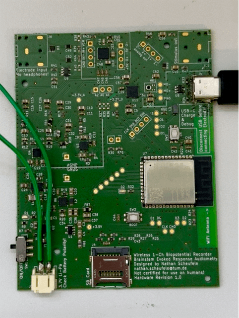
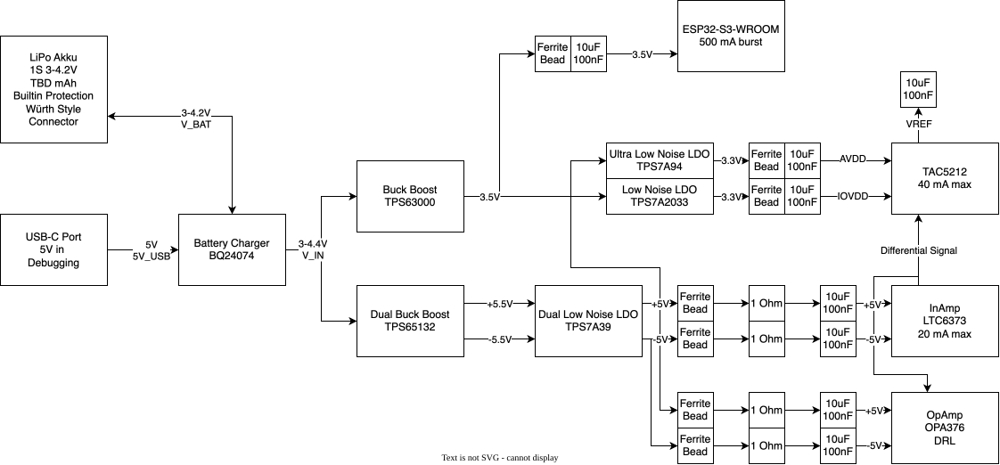

# Wireless BERA

**Wireless Biopotential Electrode Recording Amplifier**

A wireless, battery-powered biopotential recording system for EEG and auditory
brainstem response (ABR/BERA) measurements.

> **BERA** stands for two things in this project:
> - **B**rainstem **E**voked **R**esponse **A**udiometry — the clinical application
> - **B**iopotential **E**lectrode **R**ecording **A**mplifier — the hardware

> **v1.0** — fabricated at Aisler, assembled, and running. Bring-up status and
> open items: [`docs/hardware_bringup_plan.md`](docs/hardware_bringup_plan.md).




---

## Repository layout

| | |
|---|---|
| [`hardware/`](hardware/) | KiCad 10 project, symbol/footprint library, LTspice simulations, fabrication outputs |
| [`firmware/wireless_bera/`](firmware/wireless_bera/) | ESP-IDF firmware for the ESP32-S3 |
| [`docs/`](docs/) | bring-up status, codec register reference, power architecture |

`hardware/datasheets/` holds the vendor PDFs for every part. It is deliberately
kept out of git — the files are large and always re-downloadable — so a fresh
clone will not have it.

---

## Hardware

**MCU:** ESP32-S3-WROOM-1-N16R8 — Wi-Fi 802.11 b/g/n + Bluetooth 5.0 LE,
16 MB flash, 8 MB octal PSRAM.

**Analog front end**

- **LTC6373** programmable-gain instrumentation amplifier (0.25× … 16×)
- **TAC5212** 24-bit stereo codec — 2 ADC + 2 DAC channels over I²S
- **IM73A135** differential MEMS microphone for stimulus/environment monitoring
- **OPA376** driven-right-leg circuit for active common-mode rejection

**Signal path**

```
 electrode jack J6 ──► LTC6373 (PGIA) ──► TAC5212 IN2  ─┐
 MEMS mic MK1      ─────────────────────► TAC5212 IN1  ─┤ I²S ──► ESP32-S3 ──► Wi-Fi
 stimulus jack J11 ◄── TAC5212 OUT1P/OUT2P ─────────────┘
 DRL feedback      ◄── OPA376 ◄── input common mode
```

**Power** — see [power_architecture.pdf](docs/power_architecture.pdf):



- BQ24074 single-cell Li-Ion charger with power path
- TPS63000 buck-boost → 3.5 V system rail
- TPS65132W dual charge pump → ±5.4 V raw
- TPS7A39 dual ultra-low-noise LDO → ±5 V (instrumentation amplifier, DRL)
- TPS7A94 LDO → 3.3 V analog · TPS7A2033 LDO → 3.3 V digital
- Star topology and LC filters on all analog rails

**Peripherals:** microSD (SDMMC 4-bit), USB-C (USB 2.0 + ESD protection)

**PCB:** 4-layer, split GNDA/GNDD

### Daughterboard

[`hardware/daughterboard/`](hardware/daughterboard/) is an optional plug-in for
standalone LTC6373 evaluation at fixed gain 16. Stacking several of them
parallels the amplifier inputs and reduces equivalent input noise by √n.

---

## Firmware

The firmware lives in [`firmware/wireless_bera/`](firmware/wireless_bera/) — its
[README](firmware/wireless_bera/README.md) has the full picture, including the
HTTP/WebSocket API and the hardware quirks it has to respect.

It brings the analog front end up, streams both ADC channels to a browser over a
WebSocket, drives the DAC stimulus generator, and runs as its own access point
**and** as a client on an existing network at the same time.

```bash
source ~/esp/esp-idf/export.sh
cd firmware/wireless_bera
idf.py set-target esp32s3
idf.py build
```

Flash at **115200** baud — the ESP32-S3's native USB-CDC needs the slower rate
for the auto-reset handshake to line up with the macOS driver, and then no button
presses are required:

```bash
python3 -m esptool --chip esp32s3 -p /dev/cu.usbmodem101 -b 115200 \
  --before default_reset --after hard_reset write_flash \
  --flash_mode dio --flash_freq 80m --flash_size 16MB \
  0x0     build/bootloader/bootloader.bin \
  0x8000  build/partition_table/partition-table.bin \
  0x10000 build/wireless_bera.bin
```

*(To force bootloader mode by hand: hold BOOT (SW3), tap RESET (SW2), release BOOT.)*

On power-up the board raises the access point `WirelessBERA-XXXX`
(password `bera1234`) and serves its UI at <http://192.168.4.1>. The
USB-Serial/JTAG port carries both the log and a command line — type `help`, or
`wifi "My Network" mypassword` to join an existing 2.4 GHz network. Credentials
are stored in NVS only and never end up in this repository.

---

## Simulation

[`hardware/simulation/`](hardware/simulation/) holds the LTspice work behind the
analog design: transient, AC and noise runs, a common-mode/DRL testbench, and PWL
stimulus files with typical BERA waveforms.

---

## Manufacturing

[`hardware/manufacturing/`](hardware/manufacturing/) carries everything the v1.0
build was made from:

- `aisler/` — the Aisler 4-layer design-rule project
- `export/` — Gerbers, STEP models, schematic and PCB prints, BOM and Mouser order files
- `previews/` — fabrication previews and photographs of the assembled board

---

## Tools

- **EDA:** KiCad 10
- **Fabrication:** Aisler, 4-layer
- **Firmware:** ESP-IDF v5.2
- **Hardware audit:** [kicad-happy](https://github.com/aklofas/kicad-happy)

kicad-happy is cloned into `kicad-happy/` rather than vendored, and is ignored by
git. The working copy carries local modifications — custom footprint/package
checks in `skills/datasheets/scripts/datasheet_verify.py` and output logic in
`skills/kicad/scripts/analyze_schematic.py`. Commit those inside the clone before
merging upstream:

```bash
cd kicad-happy
git remote add upstream https://github.com/aklofas/kicad-happy.git
git fetch upstream && git merge upstream/main
```

### Running the audit

```bash
python3 kicad-happy/skills/kicad/scripts/analyze_schematic.py \
    hardware/WirelessBERA.kicad_sch --output /tmp/sch.json

python3 kicad-happy/skills/kicad/scripts/analyze_pcb.py \
    hardware/WirelessBERA.kicad_pcb --full --output /tmp/pcb.json

python3 kicad-happy/skills/kicad/scripts/cross_analysis.py \
    --schematic /tmp/sch.json --pcb /tmp/pcb.json --output /tmp/cross.json

python3 kicad-happy/skills/emc/scripts/analyze_emc.py \
    --schematic /tmp/sch.json --pcb /tmp/pcb.json --output /tmp/emc.json
```

---

## Author

Nathan Scheufele
