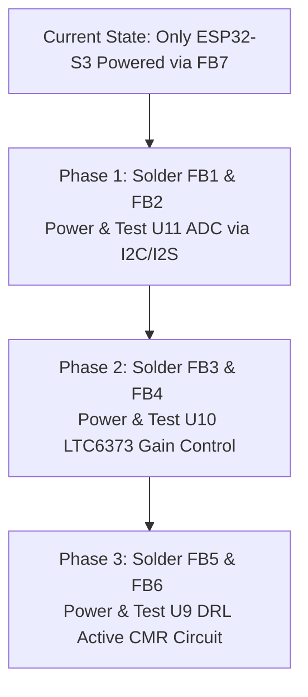

# Wireless BERA Hardware Bring-Up Plan

This document outlines the systematic, step-by-step procedure to power on, configure, and verify all sub-circuits on the Wireless BERA board. 

Currently, the board is assembled with all components **except the Ferrite Beads `FB1` through `FB6`**, meaning only the ESP32-S3 module is powered (`FB7` is soldered). We will proceed in three isolated phases.

---

---

## Phase 1: Solder FB1 & FB2 — Power & Verify TAC5212 ADC (U11)

The **TAC5212** is a 24-bit high-performance stereo ADC (`U11`) which handles biopotential recording and environmental audio. It requires independent digital (`+3.3V_TAC_D` via `FB1`) and analog (`+3.3V_TAC_A` via `FB2`) rails.

### Step-by-Step Instructions:
1. **Solder `FB1`**: This bridges `+3.3V_D` to `+3.3V_TAC_D`.
2. **Power Check (Digital)**: Connect the USB/battery. Verify that test point **`TP1`** measures exactly **`3.3 V`**.
3. **Solder `FB2`**: This bridges `+3.3V_A` to `+3.3V_TAC_A`.
4. **Power Check (Analog)**: Connect the USB/battery. Verify that test point **`TP3`** measures exactly **`3.3 V`**.
5. **Firmware Test (I2C Bus Scan)**:
   We will flash a firmware test script to scan the I2C bus (SDA = **GPIO 4**, SCL = **GPIO 5**). The TAC5212 should respond at its configured I2C address (typically `0x4C` or `0x4D`).
6. **Firmware Test (I2S Stream)**:
   We will initialize the ESP32-S3's I2S peripheral (BCLK = **GPIO 16**, FSYNC = **GPIO 15**, DOUT = **GPIO 7**) and verify that we can receive digital samples from the ADC.

---

## Phase 2: Solder FB3 & FB4 — Power & Verify LTC6373 Instrumentation Amp (U10)

The **LTC6373** is a programmable-gain instrumentation amplifier (`U10`) designed to amplify microvolt-level EEG/BERA signals. It operates on low-noise analog rails: `+5V_InAmp` via `FB3` and `-5V_InAmp` via `FB4`.

### Step-by-Step Instructions:
1. **Solder `FB3` and `FB4`**: This connects `U10` to the positive and negative 5V analog supplies.
2. **Power Check**: Verify that `U10` Pin 4/5 measures **`+5.0 V`** relative to GNDA, and `U10` Pin 13 measures **`-5.0 V`**.
3. **Firmware Test (Gain Select GPIOs)**:
   The gain of `U10` is controlled by three digital select lines:
   * `GAIN_A0` = **GPIO 8**
   * `GAIN_A1` = **GPIO 18**
   * `GAIN_A2` = **GPIO 17**
   
   We will run a test script that toggles these pins in sequence (from gain=0.25 to gain=16) and measure the voltage logic levels on the respective pins of `U10` using a multimeter/logic analyzer to confirm the control lines are active.
4. **Signal Verification**:
   Feed a small differential test signal (e.g., a 10 mV, 100 Hz sine wave) to the instrumentation amplifier inputs. Read the ADC values from U11 over I2S and verify that the signal amplitude scales correctly as you program different gains.

---

## Phase 3: Solder FB5 & FB6 — Power & Verify OPA376 DRL Driver (U9)

The **OPA376** (`U9`) implements the Driven Right Leg (DRL) circuit, which actively drives a common-mode cancellation signal back to the body. It operates on `+5V_DRL` via `FB5` and `-5V_DRL` via `FB6`.

### Step-by-Step Instructions:
1. **Solder `FB5` and `FB6`**: This connects `U9` to the active positive and negative 5V DRL supplies.
2. **Power Check**: Verify that `U9` Pin 5 measures **`+5.0 V`** and `U9` Pin 2 measures **`-5.0 V`**.
3. **Hardware Test (Common Mode Output)**:
   Measure the output of the DRL circuit. It should sit close to GNDA (0 V) when the inputs are grounded or balanced, indicating that the feedback loop is stable and in its linear range.
