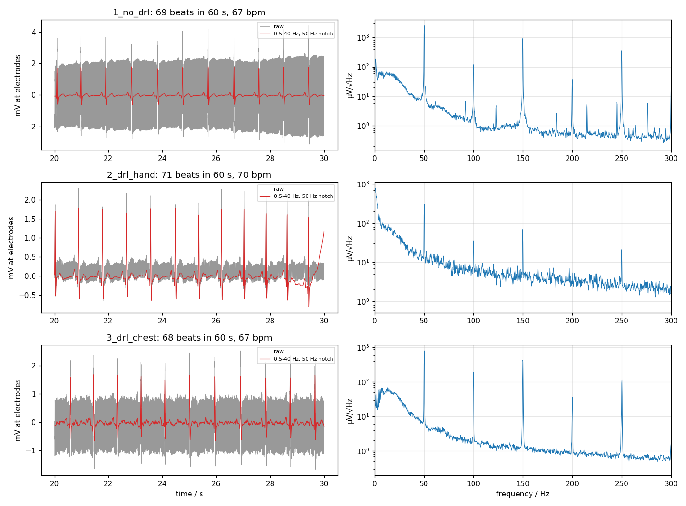

# ECG with and without driven right leg — 2026-10-16

Three 60 s recordings of a single-lead chest ECG on the author, to see what the
driven-right-leg (DRL) loop does to mains interference.

## Setup

| | |
|---|---|
| Board | Wireless BERA v1.0, firmware 2.0.0, LTC6373 fixed at G = 16 (R35–R37 not fitted) |
| Supply | battery; data streamed over Wi-Fi, laptop on battery |
| Acquisition | 48 kHz, block mean over 48 samples → **1 kHz**, 16-bit WebSocket scope stream |
| Electrodes | Philips 40493 foam electrodes, alligator clips on the snaps |
| Electrode+ (grey) | left lower rib cage |
| Electrode− (yellow) | below the right clavicle |
| DRL (green) | right lower rib cage (see per-recording notes) |

| File | DRL connection |
|---|---|
| `1_no_drl.csv` | green clip removed from its electrode — DRL loop open |
| `2_drl_hand.csv` | green clip held in the right hand instead of on the electrode |
| `3_drl_chest.csv` | green clip on the right lower rib electrode |

## File format

CSV with a 3-line `#` header, then `t_s, ch1_mic_counts, ch2_bio_counts`.
Counts are the int16 values exactly as streamed by the device.

- Volts at the codec input: `counts / 32768 × 2.8284` (full scale = 2 Vrms sine).
- Referred to the electrodes: divide by **16**, and **negate** — channel 2 is
  polarity-inverted on the board (LTC6373 OUT− drives TAC5212 IN2P).
- `ch1` is the headset electret microphone on the MK1 test points; ignore it here.
- The 1 kHz stream is a block mean, not an anti-aliased decimation.

## Results

From `../tools/analyze_ecg.py`, all values referred to the electrodes:

| | 50 Hz | 150 Hz | Heart rate | QRS (median) |
|---|---|---|---|---|
| No DRL | 1556 µVrms | 573 µVrms | 67 bpm | 1.70 mV |
| DRL via hand | 191 µVrms (−18 dB) | 43 µVrms (−22 dB) | 70 bpm | 1.69 mV |
| DRL via chest electrode | 498 µVrms (−10 dB) | 292 µVrms (−6 dB) | 67 bpm | 1.63 mV |

- The QRS complex is clearly resolved in all three recordings; no clipping, no
  lost packets.
- The DRL loop works: closing it lowers mains pickup by 10–18 dB.
- Holding the DRL lead in the hand gave the strongest mains reduction, but the
  forearm muscles add broadband EMG (the floor above 60 Hz rises roughly 3×).
  The chest electrode keeps the floor at the no-DRL level.
- Why the chest electrode suppresses less than the hand is open — contact
  impedance (the gel had little time to settle) is the first suspect.



## Reproduce

```bash
python3 ../tools/analyze_ecg.py .
```

`../tools/record_stream.py` is the recorder that produced the data (WebSocket
client; edit `HOST` for the board's address).
